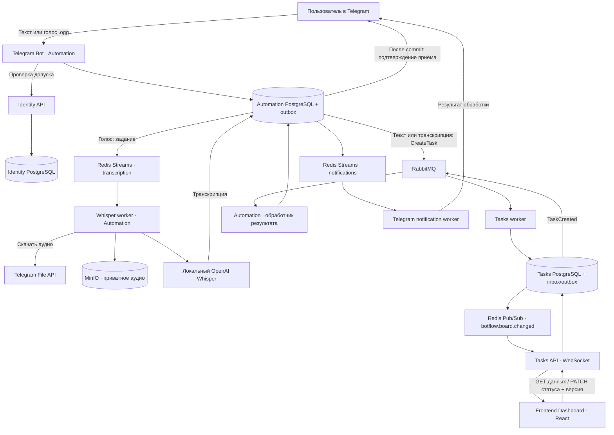

# BotFlow.AIEngineeringTask

## Описание проекта

**BotFlow** — управление задачами команды через Telegram и веб-панель.
Пользователь отправляет текст или голосовое сообщение, получает подтверждение
приёма и видит созданную задачу на общей Kanban-доске. Голос распознаётся
локальным OpenAI Whisper на русском или армянском с определением языка.

Одна команда работает с одной доской. Участник меняет статус своих задач,
администратор — любых задач, а также одобряет заявки, блокирует и разблокирует
участников. Вход в веб-панель выполняется через одноразовый код Telegram.

**Состояние:** архитектура и стартовый каркас. Есть манифесты/lockfiles,
Dockerfiles, Compose, HTTP-оболочки сервисов и начальная страница React.
Создание задач, авторизация, брокерные обработчики, миграции бизнес-данных
и STT-адаптер ещё не реализованы. `/health/live` проверяет процесс;
`/health/ready` возвращает 503 до подключения бизнес-адаптеров. Bootstrap и
workers завершаются явной ошибкой до реализации, а не имитируют обработку.

## Стек

| Область | Технологии |
| --- | --- |
| Backend | Python 3.12, FastAPI, Pydantic Settings, SQLAlchemy async, asyncpg, Alembic |
| Архитектура | Hexagonal Architecture, локальный CQRS, UoW, outbox/inbox, dependency-injector |
| Telegram | aiogram 3, long polling |
| Распознавание | Официальный локальный OpenAI Whisper, ffmpeg; подключение после проверки модели |
| Межсервисный обмен | RabbitMQ, aio-pika |
| Внутренние задания | Redis Streams: транскрипция и Telegram-уведомления |
| Realtime | Redis Pub/Sub, WebSocket, REST-синхронизация |
| Хранение | Три PostgreSQL, приватный MinIO bucket для аудио |
| Frontend | React, TypeScript, Vite, Material UI, TanStack Query, React Router |
| Инструменты | uv/uv.lock, Node 24 LTS/npm/package-lock, Ruff, mypy, ESLint, Prettier |
| Проверки | pytest, HTTPX, Vitest, React Testing Library, Playwright — сценарии добавляются с функциональностью |
| Контейнеры | Docker Compose, отдельные образы сервисов, nginx для SPA/API/WS |

## Схема взаимодействия компонентов

Схема описывает целевое поведение. Каждый сервис пишет только в свою БД.
Текст пропускает Whisper; вход и намерение обработки сохраняются до ответа бота.



RabbitMQ отвечает за команды/результаты между сервисами, Redis Streams —
за внутренние задания Automation. Pub/Sub передаёт сигнал перечитать REST,
а не надёжный журнал: после reconnect и пропущенных сигналов панель
синхронизируется заново. Временный FSM бота не является источником допуска
или состояния принятого задания.

## Структура проекта

```text
BotFlow.AIEngineeringTask/
├── README.md
├── CONTEXT.md                         # язык предметной области
├── Makefile                           # общие команды
├── docker-compose.yml                 # инфраструктура и процессы
├── .env.example                       # открытые параметры и пути секретов
├── scripts/
│   └── init-local-secrets.py           # локальные credentials без вывода значений
├── docs/
│   ├── architecture.md                # границы, потоки, надёжность и статус каркаса
│   └── adr/                           # архитектурные решения
├── infra/
│   ├── minio/Dockerfile                # сборка официального MinIO по commit SHA
│   └── redis/redis.conf                # AOF и ACL
├── frontend/
│   ├── Dockerfile
│   ├── nginx.conf                     # единый origin SPA/API/WebSocket
│   ├── package.json
│   ├── package-lock.json
│   ├── vite.config.ts
│   ├── playwright.config.ts
│   ├── e2e/                           # место браузерных сценариев
│   └── src/
│       ├── components/
│       ├── hooks/
│       ├── App.tsx
│       └── main.tsx
└── backend/
    ├── Makefile
    ├── pyproject.toml                  # uv workspace
    ├── uv.lock
    ├── libs/platform/                 # общие технические адаптеры, не бизнес-модели
    └── services/
        ├── identity-service/
        ├── tasks-service/
        └── automation-service/
            ├── Dockerfile             # у каждого сервиса свой образ
            ├── pyproject.toml
            ├── tests/
            └── src/botflow_automation/
                ├── domain/            # чистая модель и инварианты
                ├── application/       # команды, запросы и порты
                ├── infrastructure/    # БД, брокеры, S3 и внешние адаптеры
                │   └── db/
                │       ├── alembic.ini
                │       └── alembic/
                ├── api/               # HTTP-оболочка
                ├── bot/               # Telegram ingress
                ├── worker/            # фоновые процессы
                ├── containers.py      # composition root dependency-injector
                └── bootstrap.py       # отдельная подготовка ресурсов
```

Identity и Tasks имеют аналогичные слои, собственные миграции и workers.
Бизнес-модели не разделяются через общую библиотеку и не читают чужие БД.

## Начало работы

Нужны Docker с Compose, Python для служебных скриптов; для локальных проверок —
uv и Node 24 LTS/npm. Секреты не входят в репозиторий.

```bash
cp .env.example .env
make init            # создаёт .secrets, существующие значения не перезаписывает
make compose-check   # проверка конфигурации без печати секретов
make build           # сборка стартовых образов
make infra           # PostgreSQL, Redis, RabbitMQ, MinIO
make run             # HTTP-оболочки и начальная страница на localhost:8080
make down            # остановка с сохранением томов
```

MinIO собирается из официального исходника с закреплённым SHA, поскольку
старый тег контейнера из архитектурного референса недоступен. Сборка требует
сети и отдельно проверяется перед рабочим запуском. Веса Whisper готовятся
отдельно; его Python-зависимости добавляются после проверки совместимости.

`make deps` явно устанавливает зависимости. `make check`, `make test`,
`make build`, `make e2e` — интерфейс будущего полного QA. Пока поведенческих
тестов и изолированного E2E-окружения нет, тестовый gate не считается готовым:
pytest не принимает пустой набор, E2E явно отказывает. `make setup`/`make demo`
требуют реализации bootstrap и миграций. Профили `workers` и `bootstrap`
содержат точки входа, а не работающие бизнес-обработчики.

Архитектурные детали и принятые компромиссы: [docs/architecture.md](docs/architecture.md),
[ADR](docs/adr/).
