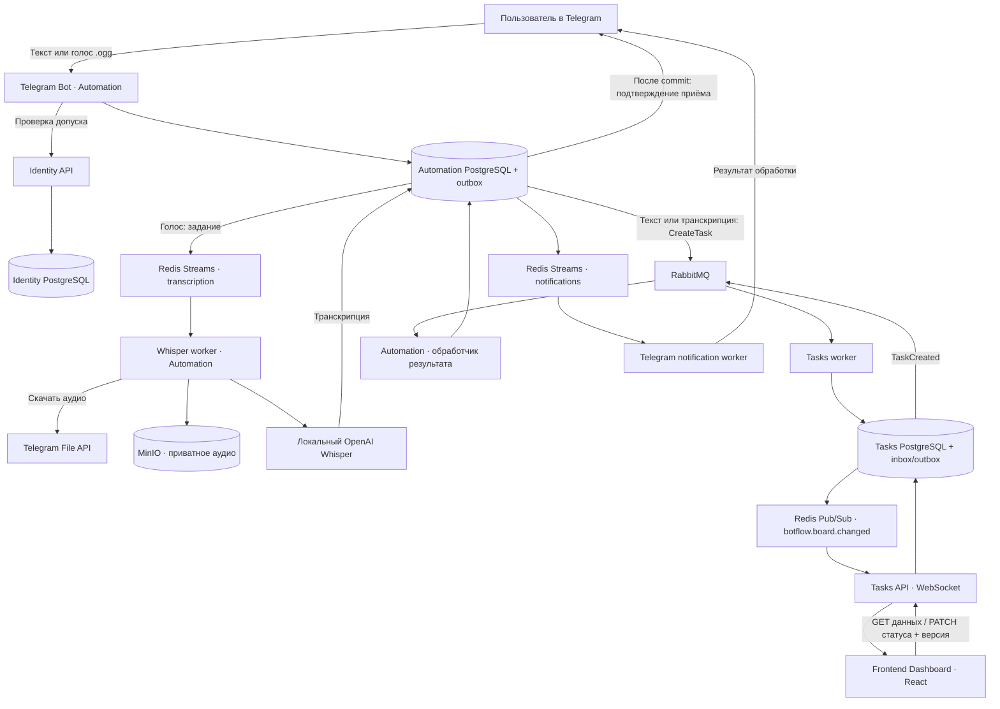

# BotFlow.AIEngineeringTask

## Описание проекта

**BotFlow** — управление задачами команды через Telegram и веб-панель.
Пользователь отправляет текст или голосовое сообщение, получает подтверждение
приёма и видит созданную задачу на общей Kanban-доске. Голос распознаётся
локальным OpenAI Whisper на русском или армянском с определением языка.

Одна команда работает с одной доской. Участник меняет статус своих задач,
администратор — любых задач, а также одобряет заявки, блокирует и разблокирует
участников. Вход в веб-панель выполняется через одноразовый код Telegram.
Веб-интерфейс поддерживает русский и армянский с переключателем языка;
визуальное направление — светлая доска, графитовые поверхности и золотистые акценты
под собственным названием BotFlow. [Дизайн и локализация](docs/frontend-design.md).

Первая версия ориентирована на полный демонстрационный сценарий: базовые
повторы, дедупликация и восстановление после рестарта. Расширенные процедуры
аварийного восстановления и эксплуатации отложены: [ADR-0021](docs/adr/0021-proportionate-reliability.md).

**Состояние:** инфраструктурный каркас с DI lifecycle, изолированным smoke и CI. Есть манифесты/lockfiles,
Dockerfiles, Compose, HTTP-оболочки сервисов и начальная страница React.
Оболочка использует общую MUI тему BotFlow и локальные шрифты; переключатель
«Русский / Հայերեն» сохраняет выбор в браузере и обновляет язык документа.
Создание задач, авторизация, брокерные обработчики, миграции бизнес-данных
и STT-адаптер ещё не реализованы. `/health/live` проверяет процесс;
`/health/ready` возвращает 503 до подключения бизнес-адаптеров. Bootstrap и
workers завершаются явной ошибкой до реализации, а не имитируют обработку.

## Стек

| Область | Технологии |
| --- | --- |
| Backend | Python 3.12, FastAPI, Pydantic Settings, SQLAlchemy async, asyncpg, Alembic |
| Архитектура | Hexagonal Architecture, локальный CQRS, UoW, outbox/inbox, dependency-injector |
| Telegram | aiogram 3, long polling |
| Распознавание | Официальный локальный OpenAI Whisper, ffmpeg; подключение после проверки модели |
| Межсервисный обмен | RabbitMQ, aio-pika |
| Внутренние задания | Redis Streams: транскрипция и Telegram-уведомления |
| Realtime | Redis Pub/Sub, WebSocket, REST-синхронизация |
| Хранение | Три PostgreSQL, приватный MinIO bucket для аудио |
| Frontend | React, TypeScript, Vite, Material UI, TanStack Query, React Router |
| Инструменты | uv/uv.lock, Node 24 LTS/npm/package-lock, Ruff, mypy, ESLint, Prettier |
| Проверки | pytest, HTTPX, Vitest, React Testing Library, Playwright — сценарии добавляются с функциональностью |
| Контейнеры | Docker Compose, отдельные образы сервисов, nginx для SPA/API/WS |

## Схема взаимодействия компонентов

Схема описывает целевое поведение. Каждый сервис пишет только в свою БД.
Текст пропускает Whisper; вход и намерение обработки сохраняются до ответа бота.



RabbitMQ отвечает за команды/результаты между сервисами, Redis Streams —
за внутренние задания Automation. Pub/Sub передаёт сигнал перечитать REST,
а не надёжный журнал: после reconnect и пропущенных сигналов панель
синхронизируется заново. Временный FSM бота не является источником допуска
или состояния принятого задания.

## Структура проекта

```text
BotFlow.AIEngineeringTask/
├── README.md
├── CONTEXT.md                         # язык предметной области
├── Makefile                           # общие команды
├── docker-compose.yml                 # инфраструктура и процессы
├── .env.example                       # открытые параметры и пути секретов
├── scripts/
│   └── init-local-secrets.py           # локальные credentials без вывода значений
├── docs/
│   ├── architecture.md                # границы, потоки, надёжность и статус каркаса
│   ├── frontend-design.md             # визуальное направление и RU/HY
│   └── adr/                           # архитектурные решения
├── infra/
│   ├── minio/Dockerfile                # сборка официального MinIO по commit SHA
│   └── redis/redis.conf                # AOF и ACL
├── frontend/
│   ├── Dockerfile
│   ├── nginx.conf                     # единый origin SPA/API/WebSocket
│   ├── package.json
│   ├── package-lock.json
│   ├── vite.config.ts
│   ├── playwright.config.ts
│   ├── e2e/                           # место браузерных сценариев
│   └── src/
│       ├── components/
│       ├── hooks/
│       ├── App.tsx
│       └── main.tsx
└── backend/
    ├── Makefile
    ├── pyproject.toml                  # uv workspace
    ├── uv.lock
    ├── libs/                           # общие технические библиотеки, не бизнес-модели
    │   ├── kernel-domain/              # Result, Error, Entity, DomainEvent
    │   ├── kernel-platform/            # HTTP-контракт, UoW, outbox, воркеры
    │   ├── observability/              # request id, логи
    │   └── test-support/               # общие тестовые двойники
    └── services/
        ├── identity-service/
        ├── tasks-service/
        └── automation-service/
            ├── Dockerfile             # у каждого сервиса свой образ
            ├── pyproject.toml
            ├── src/                   # корень импортов конкретного сервиса
            │   ├── domain/            # чистая модель и инварианты
            │   │   ├── entities/
            │   │   ├── value_objects/
            │   │   ├── events/
            │   │   ├── repositories.py
            │   │   └── unit_of_work.py
            │   ├── application/       # commands/, queries/, ports.py
            │   ├── infrastructure/    # реализации портов: db/, security/
            │   │   └── db/
            │   │       ├── alembic.ini
            │   │       └── alembic/
            │   ├── api/               # HTTP, схемы, containers.py, worker/bot/bootstrap
            │   ├── contracts/         # framework-independent View: frozen dataclasses
            │   ├── core/              # кросс-срезная политика сервиса
            │   └── common/            # локальные утилиты
            ├── tests/
            │   ├── unit/
            │   ├── integration/
            │   ├── e2e/
            │   └── performance/
            ├── k8s/
            ├── docs/
            ├── ci/
            └── scripts/               # служебные CLI (voice_latency, whisper_validate)
```

Identity и Tasks имеют такую же структуру, собственные миграции и workers.
Слои лежат непосредственно в `src/`; у каждого процесса свой корень импортов.
Правила запуска и изоляции описаны в [локальной инфраструктуре](docs/local-infrastructure.md).
Бизнес-модели не разделяются через общую библиотеку и не читают чужие БД.

## Начало работы

Нужны Docker с Compose, Python для служебных скриптов; для локальных проверок —
uv и Node 24 LTS/npm. Секреты не входят в репозиторий.

```bash
cp .env.example .env
make init            # создаёт .secrets, существующие значения не перезаписывает
make compose-check   # проверка конфигурации без печати секретов
make build           # сборка стартовых образов
make infra           # PostgreSQL, Redis, RabbitMQ, MinIO
make run             # HTTP-оболочки и начальная страница на localhost:8080
make down            # остановка с сохранением томов
make smoke           # собственные PG/RabbitMQ/Redis/MinIO, DI/S3, down/up; очистка тестовых томов
```

MinIO собирается из официального исходника с закреплённым SHA, поскольку
старый тег контейнера из архитектурного референса недоступен. Сборка требует
сети и отдельно проверяется перед рабочим запуском.

Whisper проверяется отдельно от приложения (#4): `make whisper-build` (образ
Python 3.12 + openai-whisper + torch CPU + ffmpeg), `make whisper-prepare`
(единственный шаг с сетью, веса в том `botflow_whisper_models`, SHA-256; `turbo` ≈1.5 GiB),
`make whisper-verify`, `make whisper-corpus-check`, `make whisper-bench` (без сети;
корпус из `.local/whisper/`, результат `.local/whisper/results.json`). Корпус и результаты
не коммитятся. Установка и загрузка выполняются только явно. По замерам на шести записях выбрана
`turbo` (CPU, fp32); качество на hy низкое, а STT на длинной hy-записи около 58 с — подтверждения
владельца нет. Подробности и ограничения:
`backend/services/automation-service/docs/whisper-validation.md`.

`make deps` явно устанавливает зависимости из lockfiles. `make check` и
`make test` проверяют текущий backend/frontend и служебные скрипты; пустой набор
pytest/Vitest не считается успешным. `make build` собирает образы.
`make smoke` поднимает реальные ресурсы в уникальном Compose-проекте, проверяет
DI, независимые DB-сессии с rollback, RabbitMQ/Redis, приватный S3 roundtrip и
сохранность данных после down/up. Тестовые credentials и тома отделены от `.secrets`
и локального стенда; удаляются только ресурсы этого тестового проекта.

`make e2e` запускает тот же изолированный smoke и Playwright на обычном и узком
экране. Вход проходит через настоящий Identity API/nginx и PostgreSQL: код
получает реальный обработчик `/login`, отправку сообщения перехватывает тестовый
Telegram-адаптер. Проверяются восстановление сессии, RU/HY, logout, повтор кода,
истечение и отзыв сессии. Admin-сценарии проходят через настоящие `/join`,
списки и решения API: отказ, повторная заявка, одобрение, блокировка с отзывом
доступа, разблокировка и конфликт конкурентного решения. Проверяется серверный
запрет admin API для обычного пользователя. Chromium готовится явно:
`npm --prefix frontend exec -- playwright install chromium` (в Ubuntu CI добавляется
`--with-deps`). Эти проверки не подтверждают создание задач, живой Telegram
long polling или качество STT. Tasks bootstrap и фоновые обработчики задач
ещё не реализованы; Identity bootstrap и миграции входа работают.

Веб-вход доступен через Compose ingress: отправьте боту `/login` в личном чате,
вставьте 32-символьный код на `/login`. Он одноразовый и действует 5 минут.
`/` требует активной сессии; кнопка «Выйти» отзывает её. Сессия проверяется после
загрузки, при возвращении на вкладку/восстановлении соединения и каждые 30 секунд
активной вкладки. RU/HY переключается без повторного входа; localStorage хранит
только язык. При недоступном Identity защищённая оболочка скрыта и доступен повтор.

Администратору доступен `/admin` по ссылке «Управление доступом»: ожидающие
и отклонённые заявки, допущенные и заблокированные участники, страницы по 20
записей. Одобрение, отказ, блокировка и разблокировка передают показанную
`access_version`; после ответа список перечитывается. Действия не повторяются
автоматически. При ошибке перечитывания старые действия скрыты до успешного
обновления списка. Интерфейс и ошибки доступны на RU/HY; право admin проверяет
сервер при каждом запросе.

Оболочку можно проверить отдельно от API и Docker:
`npm --prefix frontend run test:ui` запускает собственный Vite и Playwright
на широком экране и ширине 320 px. На HTTP-границе подменяются ответы Identity:
проверяются состояния входа и admin-экрана, ошибки RU/HY, отзыв сессии,
конфликт решения, 503 и потеря ответа без повторной отправки действия,
постраничные списки, повтор после 503,
локальные шрифты, отсутствие переполнения и клавиатурный focus.
Для разработки только интерфейса: `npm --prefix frontend run dev`; настоящий вход
требует единого origin SPA/API через Compose ingress.

GitHub Actions выполняет установку по lockfiles, `make check`, `make test`,
`make build` и изолированный smoke с браузерной проверкой через `make e2e`.
Подробности lifecycle, изоляции и диагностики: [локальная инфраструктура](docs/local-infrastructure.md).

Архитектурные детали и принятые компромиссы: [docs/architecture.md](docs/architecture.md),
[ADR](docs/adr/).
