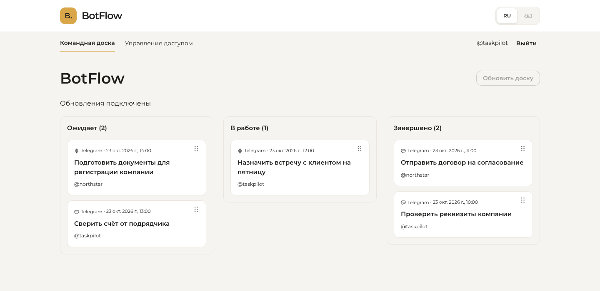

# BotFlow

Управление задачами через Telegram и общую веб-панель. Участник отправляет
боту текст или голосовое сообщение, а задача появляется на Kanban-доске.
Распознавание речи выполняется локально с помощью OpenAI Whisper.



## Возможности

- Создание задач из текста и голосовых сообщений в Telegram.
- Доска с тремя статусами, перетаскиванием карточек и обновлением без перезагрузки.
- Вход по одноразовому коду из бота, заявки на доступ и управление участниками.
- Разграничение прав: участник меняет свои задачи, администратор — любые.
- Интерфейс на русском и армянском языках, поддержка узкого экрана.
- Фоновая обработка, защита от повторного создания задачи и повтор упавших заданий.

## Архитектура



[Интерактивная схема](docs/presentation/botflow-architecture.html) подготовлена через
[archify](https://github.com/tt-a1i/archify) по коду проекта.

| Сервис | Ответственность |
| --- | --- |
| Identity | Участники, допуск, роли и сессии |
| Tasks | Задачи, статусы, версии и WebSocket доски |
| Automation | Telegram-бот, голосовые задания и уведомления |

У каждого сервиса своя PostgreSQL. RabbitMQ передаёт команды и результаты между
сервисами, Redis Streams обслуживает фоновые задания Automation. Аудио хранится
в приватном bucket MinIO. Панель получает сигнал через WebSocket и перечитывает
данные по REST.

**Стек:** Python 3.12, FastAPI, SQLAlchemy, PostgreSQL, RabbitMQ, Redis, MinIO,
Whisper, React, TypeScript, Vite, Docker Compose.

## Запуск

Нужны Docker с Compose, Python 3.12, uv, Node.js 24 и токен Telegram-бота.

```bash
cp .env.example .env
make init
```

В `.env` задайте `INITIAL_ADMIN_TELEGRAM_ID`, а токен бота запишите в
`.secrets/telegram_bot_token`. Затем подготовьте веса модели и запустите стенд:

```bash
make whisper-prepare
make demo
```

Веб-панель: [localhost:8080](http://localhost:8080). Для входа отправьте боту
`/login` и вставьте полученный код. `make down` останавливает стенд с сохранением данных.
Подробная настройка и команды оператора — в [руководстве запуска](docs/runbook.md).

## Проверки

```bash
make deps       # установка зависимостей из lockfiles
make check      # линтеры, типы и форматирование
make test       # backend и frontend
make build      # Docker-образы
make e2e        # изолированный стенд и Playwright
```

[GitHub Actions](https://github.com/PVMalove/BotFlow.AIEngineeringTask/actions/workflows/ci.yml)
выполняет эти проверки при push и для pull request. E2E использует реальные
PostgreSQL, RabbitMQ, Redis и MinIO, тестовые адаптеры Telegram и распознавания речи.
Ручная проверка приложения проведена на двух пользователях.

## Материалы

- [Презентация проекта, PDF](docs/presentation/BotFlow.pdf)
- [Архитектура и потоки данных](docs/architecture.md)
- [Принятые решения](docs/adr/)
- [Дизайн и локализация](docs/frontend-design.md)

Проект выполнен как тестовое задание. Исходные материалы и локальные секреты
не включены в репозиторий.
